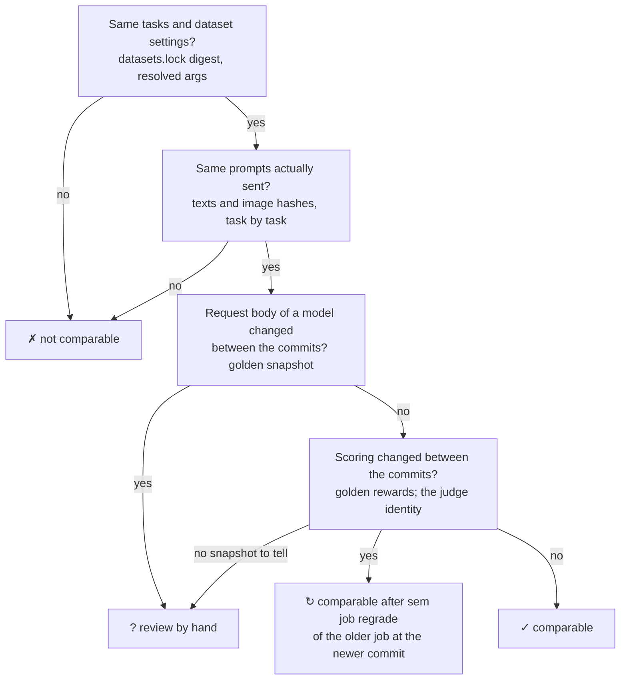

# Compare results

Two jobs can be compared on a dataset when they asked the model the same questions in the same way and scored the
answers the same way. Jobs made at the same commit always can. Jobs made at different commits (other versions) can
too, as long as nothing that decides the prompts or the rewards of **that dataset** changed between them; a version
number alone does not say so ([Versioning](../versioning.md)). `sem jobs compare` checks it per dataset:

```bash
uv run --frozen sem jobs compare jobs/mine jobs/theirs
```



| Mark | Meaning | What to do |
|---|---|---|
| ✓ | same tasks, same prompts, same scoring | compare |
| ↻ | same prompts; the scoring (verifier code or judge) differs | `sem job regrade` the older job at the newer commit (no model calls), then compare |
| ? | something changed that the checks cannot decide | read the note; once checked, record it (the leaderboard spec's `comparability_reviewed`) |
| ✗ | other tasks, settings or prompts | not comparable: rerun one of them at the other's version |

Examples:

| Change between the two jobs' commits | Result |
|---|---|
| a new dataset added, the site code edited | ✓ (other datasets' files only) |
| a framework file changed, but every task was sent the same prompt | ✓, the changed files listed as a note |
| a verifier bug fix (e.g. a regex) | ↻ when the dataset's golden rewards changed, else ✓ |
| another `--judge-model` | ↻ |
| the dataset's prompt template changed | ✗ (the prompts sent differ) |
| a dataset arg such as LiveCodeBench's date window | ✗ (other tasks); the same window given explicitly or by default is ✓ |

`sem site build` runs the same check on every leaderboard column.

## Across versions

Each release lists the datasets it changes (`sem datasets diff <previous tag> <tag>`, see
[Data locks and snapshots](../datasets/data-locks.md#what-a-release-changes)); `sem jobs compare` decides for actual
jobs from what they recorded. To put your results next to another team's, see [Sharing](sharing.md).
